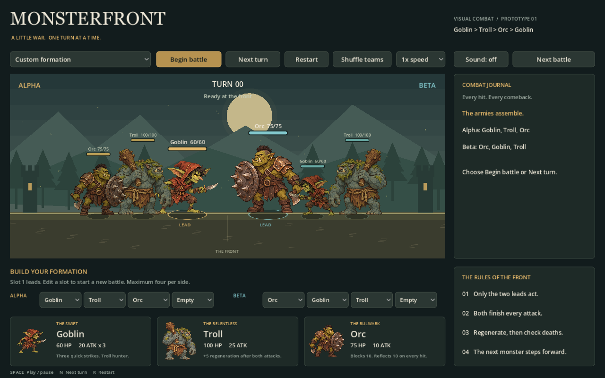

# Monsterfront

**godot_base_turn_combat** is a native 2D turn-based combat prototype made with
Godot and GDScript. Build two formations of goblins, trolls, and orcs, then watch
their leading monsters exchange attacks and abilities. Health bars, combat
effects, and an action journal make each result easy to follow.



## Project background

- **September 2026:** original SMU programming assignment in C++.
- **November 2026:** combat logic and numerical balance refined, then extended
  into the Godot visual prototype presented here.

The design focuses on cyclic monster advantages, consistent turn resolution,
and readable visual feedback. This repository contains the standalone visual
game. The C++ assignment is the project's origin and is not a runtime dependency.

## Run the game

Use **Godot 4.7.2**, the version used to verify this project, with its
**Compatibility** renderer. No plugins, package installation, or online account
are required.

### Godot editor

1. Download or clone the repository.
2. In Godot, choose **Import** and select `project.godot`.
3. Open the project and let Godot import the textures.
4. Press **F5** to run the main scene.

### Windows launcher

`RunDemo.cmd` finds `godot.exe` or `godot4.exe` on `PATH`. If Godot is installed
elsewhere, set its executable path before launching:

```bat
set "GODOT_EXE=C:\Tools\Godot\Godot_console.exe"
RunDemo.cmd
```

The launcher imports assets and starts the game. It does not download or install
the engine. `GODOT_EXE` should name the executable file itself.

### Command line

From the repository directory, with Godot available as `godot`:

```sh
godot --headless --editor --path . --import --quit
godot --path .
```

Godot regenerates the local `.godot` cache from the supplied source assets and
import settings.

## Playing

Each team has up to four monsters. Slot 1 leads, and the next monster advances
when that lead dies. The initial custom formation includes all three species
on each side.

| Control | Action |
| --- | --- |
| Begin battle or Resume | Automatically play consecutive turns |
| Pause | Finish the current turn, then stop auto-play |
| Next turn | Animate one complete turn |
| Restart | Restore the current teams at full health |
| Scenario selector | Choose a required matchup or a custom formation |
| Next battle | Cycle through the seven assignment scenarios |
| Formation slots | Edit either team and begin a new battle |
| Shuffle teams | Generate two random four-monster teams |
| 1x, 2x, or 4x speed | Change animation pacing |
| Sound | Toggle synthesized combat tones, initially off |
| Space / N / R | Play or pause / next turn / restart |

Empty formations disable combat. Simultaneous elimination is reported as a draw.

## Combat design

### Turn sequence

1. Both leads finish every attack, including blocking and reflection.
2. Both leads use regeneration.
3. Resolve health and check both deaths.
4. Advance surviving queues. Replacements act on the next turn.

Damage remains in a per-turn tally until regeneration is applied. Excess damage
is preserved, and resolved health stays within zero and the monster's starting
maximum. Reflection does not trigger another reflection. Only the two leads act;
waiting trolls do not regenerate.

### Monster attributes

| Monster | Health | Damage per hit | Attacks per turn | Special ability |
| --- | ---: | ---: | ---: | --- |
| Goblin | 60 | 20 | 3 | Repeated attacks and the highest raw damage per turn |
| Troll | 100 | 25 | 1 | Regenerates 5 health after the attack phase |
| Orc | 75 | 10 | 1 | Blocks 10 and reflects 10 damage on every incoming hit |

The goblin's repeated hits overcome troll regeneration. The troll's strong
individual attack penetrates the orc's shield. The orc's reflection punishes
the goblin for attacking several times. Each advantage is limited: one monster
still loses to two opponents of the species it counters.

### Required scenarios

| Battle | Winner | Turns |
| --- | --- | ---: |
| Goblin vs troll | Goblin | 2 |
| Goblin vs two trolls | Trolls | 3 |
| Troll vs orc | Troll | 5 |
| Troll vs two orcs | Orcs | 7 |
| Orc vs goblin | Orc | 2 |
| Orc vs two goblins | Goblins | 3 |
| Random four vs random four | Depends on the formation | Varies |

The six fixed results are unchanged when the teams swap positions.

## Implementation

The combat model computes a complete turn and emits structured attack,
regeneration, death, and result events. The presentation controller animates
those events. Frame rate, playback speed, and sound do not change the outcome.
Restarting or changing a formation invalidates delayed animation continuations
so they cannot update a replacement battle.

| Path | Responsibility |
| --- | --- |
| `project.godot` | Engine configuration and main scene |
| `scenes/main.tscn` | Game entry scene |
| `scripts/combat.gd` | Attributes, scenarios, and deterministic turn resolution |
| `scripts/main.gd` | Interface, event playback, combat effects, and sound |
| `scripts/fighter.gd` | Character artwork, health bars, and animation |
| `scripts/arena.gd` | Procedural battlefield and ambient effects |
| `assets/` | Monster textures and their import settings |
| `screenshots/` | Gameplay image used by this README |
| `RunDemo.cmd` | Windows import and launch helper |

The visual pass includes idle motion, attack anticipation and lunges, hit
reactions, death falls, queue advancement, slash trails, shield flashes,
reflection indicators, and regeneration particles. Character animation uses
transformed cutouts and tweens rather than frame-by-frame drawings or a skeleton.

## Validation

The development verification suite checks the six required matchups in both
team positions and all **6,561 ordered four-versus-four formations** against an
independent arithmetic model. Winners, turn counts, and surviving lead health
agree. The longest tested battle takes **32 turns**; **1,403** formations end in
simultaneous elimination.

Additional checks cover health limits, lethal-hit regeneration, excess damage,
complete death-turn attacks, turn stepping, victory presentation, random team
sizes, empty formations, and restarting during an attack animation.

## Scope and credits

This is a playable combat prototype with one battlefield. Its current scope is
formation-based battles; an economy, base destruction, evolution, and campaign
progression are outside this version.

The side-view presentation takes inspiration from opposing armies and readable
unit roles in [Age of War](https://www.maxgames.com/guides/age-of-war-2.html).
No Age of War artwork or source code is included.

The project direction, design goals, and final choices are the author's. AI was
used to assist implementation, parameter exploration, debugging, testing, and
documentation. The three monster illustrations are AI-generated prototype
assets. Animation and combat effects are implemented in Godot; the artwork is
not presented as hand-drawn.
